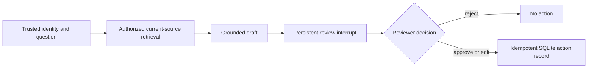

# 15.1 — Specify the support assistant before connecting components

**In plain words:** Before wiring anything, write down what the support assistant must do: who can ask, what it may read, where a human reviews, and what effect an approval has.

**Objective:** define observable behavior, data boundaries, and the smallest architecture that satisfies them.

**Prerequisites:** [RAG](../07_rag/01.md), [evaluation](../08_evaluation/01.md), [durable approval](../10_durable_approval/01.md), and [serving](../14_production/01.md). The installed dependency snapshot and live limitations are recorded in [the verification report](../../docs/VERIFICATION.md); APIs are pinned by `uv.lock`.

## Recall before reading

Explain why a source ID is not proof of claim support. Then explain why checkpoint persistence alone does not guarantee that a side effect happens only once. Compare your reasoning with the earlier RAG and approval lessons before continuing.

## The product contract

A request arrives with a trusted user identity and a thread identifier. The assistant searches only sources visible to that identity, drafts an evidence-grounded response, and pauses for review. A reviewer approves, rejects, or edits the proposal. Approval records a **synthetic local action**; this course does not send email or create a production ticket.

The synthetic corpus includes `RETURN` v2 (30 calendar days, unused item and receipt), an obsolete version with a different period, and conflicting current remote-work sources. These are deliberately different failure classes: an obsolete record should be filtered; two genuinely current contradictions should not be silently collapsed into one fact.

LangChain handles the model interaction; LangGraph exposes the state transitions and review point; SQLite persists checkpoints and the local sink. More agents are not required by this contract. Use [the multi-agent lesson](../12_multi_agent/01.md) to justify a specialist only if it improves measured outcomes.

## Worked design decision

The concrete invariant “Bob cannot inspect or approve Alice's thread” must hold both before and after restart. A `user_id` inside a client request is not enough: the server binds a bearer token to identity, and the workflow checks persisted thread ownership. The model is not asked to decide whether Bob is permitted.

Read the implementation entry points in `retrieval.py`, `rag.py`, and `workflow.py`. Identify the input/output boundary at each transition. State which component can fail because of an unavailable provider and which components can be exercised without one.

## Guided and independent practice

First, map the architecture to the capstone lab's `start`, `inspect`, and decision commands. Then replace the return-policy question with a warranty question. Predict which stages change and which invariants do not. Do not copy a worked solution before making the prediction.

For a failure investigation, propose a change that removes the source-version filter. Identify the consumer-visible error it could create; inspect retrieval evidence before adjusting any prompt.

**Exit check:** explain authorization, evidence, persistence, and local effect scope in your own words. Revisit this architecture when writing the final tutorial; diagrams should reflect observed behavior, not intended wiring.

**Sources:** [Retrieval architectures](https://docs.langchain.com/oss/python/langchain/retrieval), [LangGraph persistence](https://docs.langchain.com/oss/python/langgraph/persistence). Ask the teaching assistant for one diagnostic hint at a time if a boundary remains unclear.

**What a successful run looks like:** see the [captured `--check` output](../../labs/15_capstone/README.md#captured---check-output).
